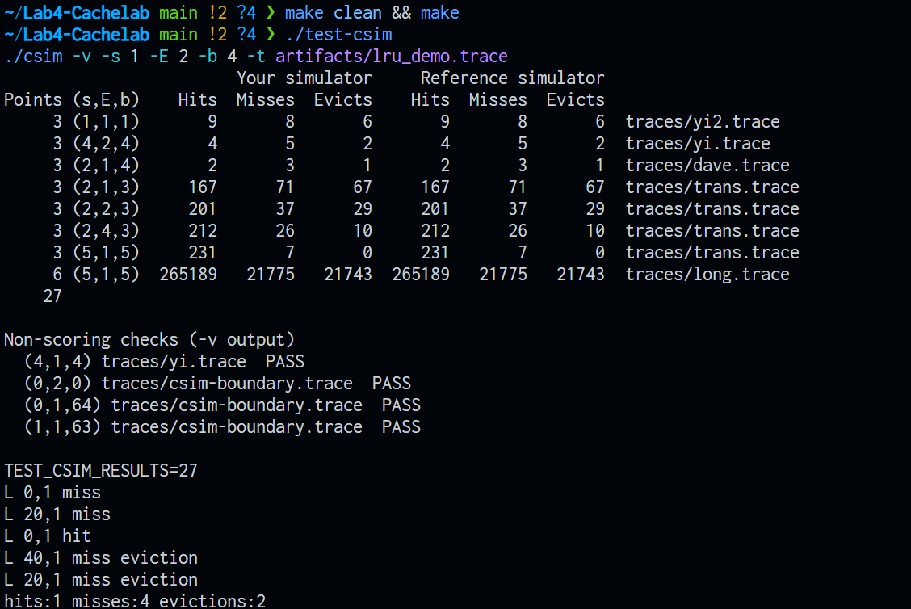
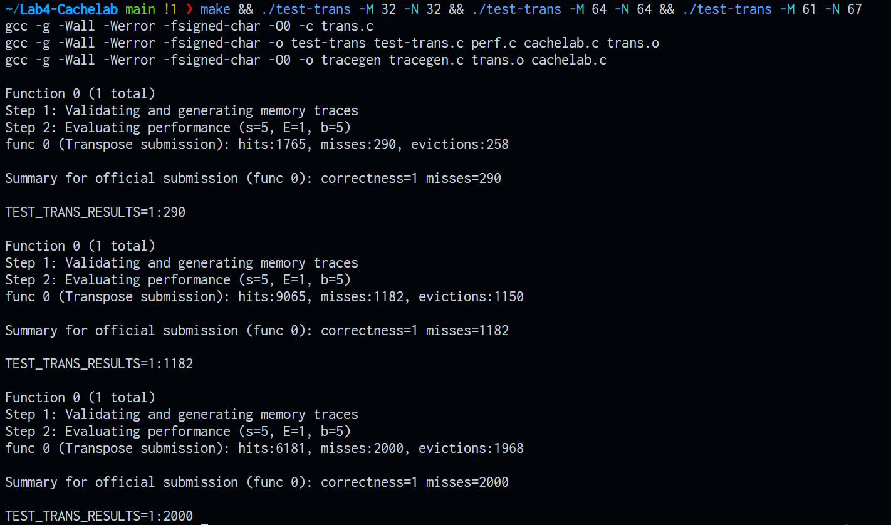
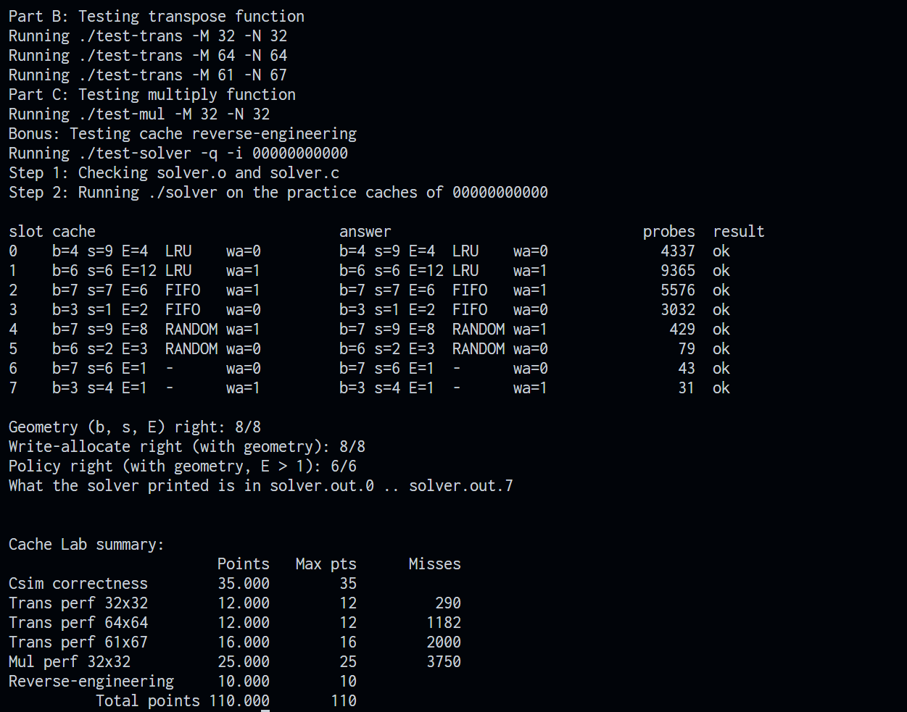

# Cache Lab 实验报告

| 项目 | 内容                |
| ---- | ------------------- |
| 姓名 | 周天佑              |
| 学号 | 25300680065         |
| 日期 | 2026 年 11 月 24 日 |

## 实验环境

| 项目     | 结果                                              |
| -------- | ------------------------------------------------- |
| 运行环境 | WSL2，Linux `6.18.58.1-microsoft-standard-WSL2` |
| 架构     | x86_64                                            |
| 编译器   | `gcc (Ubuntu 15.2.0-16ubuntu1) 15.2.0`          |
| 构建方式 | `make clean && make`                            |
| 编译选项 | `-g -Wall -Werror -fsigned-char`                |

## Part A 缓存模拟器

### 1 任务概述与实现范围

本部分要求实现一个基于 LRU 策略的缓存模拟器。程序接收缓存参数 `s`、`E`、`b` 和 trace 文件，逐条重放其中的数据访问，统计命中（hit）、缺失（miss）和替换（eviction）次数；在 `-v` 模式下，还需按照参考程序的格式输出每次访存的具体结果。

实验框架已经提供了参数解析、缓存空间分配、trace 文件读取、指令访问过滤和最终汇总的代码。我们需要补齐的核心逻辑集中在 `access_cache(uint64_t addr)`：根据访存地址定位缓存组与 tag，判断是否命中，维护 LRU 时间戳，并在缺失时完成空行装入或缓存行替换。

| 内容                          | 位置                |
| ----------------------------- | ------------------- |
| 缓存行结构与全局状态          | `csim.c:23-33`      |
| 单次访问处理                  | `csim.c:59-109`     |
| trace 重放及 `M` 的两次访问   | `csim.c:111-132`    |
| 参数解析、缓存分配与释放      | `csim.c:134` 以后   |

最终实现完整覆盖了普通命中、冷缺失、空行装入、LRU 替换、verbose 输出，以及 $s=0$、$s+b=64$ 两个边界情形。Part A 的 `test-csim` 评测得分为 27/27，8 个计分测例的结果与参考模拟器完全一致，4 个检查完整 `-v` 输出的非计分诊断测例也全部通过。

### 2 缓存模型与数据结构

缓存共有 $S=2^s$ 个组，每组包含 $E$ 行，每行存储一个大小为 $B=2^b$ 字节的数据块，因此缓存的总数据容量为：

$$
S \times E \times B = 2^s \times E \times 2^b \text{ 字节}
$$

程序使用 `line_t` 结构体表示单个缓存行：

| 字段        | 作用                                                                                 |
| ----------- | ------------------------------------------------------------------------------------ |
| `valid`     | 标记当前行是否存有有效数据块。初始值为 0；只有为 1 时，行内的 `tag` 才参与比对。     |
| `tag`       | 保存块地址除去块内偏移和组索引后的高位部分，用于区分映射到同一组的不同内存块。       |
| `last_used` | LRU 时间戳。数值越大表示最近刚被访问过，发生替换时选择该数值最小的行换出。           |

在内存中，`cache` 被分配为一维连续数组。第 $i$ 组的 $E$ 行从下标 $iE$ 开始连续存放，因此第 $i$ 组第 $j$ 行对应 `cache[i * E + j]`。每次访存时，先根据地址计算出组号 $i$，再在 $iE$ 到 $iE+E-1$ 的下标范围内逐行扫描。

`tick` 是全局递增的逻辑时钟。每次调用 `access_cache()` 时先将其加一，再把新值赋给目标行的 `last_used`。这样在单次运行过程中，每次访存都会获得唯一且递增的时间戳；无论是命中、装入空行还是发生替换，都会同步更新该时间戳。

### 3 地址拆分

模拟器处理的是 64 位字节地址。对于给定的地址 `addr`，三个组成部分的提取方式如下：

| 部分                   | 取法                                                |       位数 |
| ---------------------- | --------------------------------------------------- | ---------: |
| 块偏移（block offset） | $addr \bmod 2^b$，即最低 $b$ 位                 |      $b$ |
| 组索引（set index）    | $\left\lfloor addr / 2^b \right\rfloor \bmod 2^s$ |      $s$ |
| 标记 `tag`           | $\left\lfloor addr / 2^{b+s} \right\rfloor$       | $64-b-s$ |

其中，块偏移决定数据在块内的字节位置；组索引决定去哪个缓存组查找；tag 则与组索引共同标识唯一的一个内存块。由于实验假设每次数据访问不会跨越块边界，块偏移本身不参与命中判断。

#### 3.1 $s=4,b=4$ 的地址例子

当 $s=4, b=4$ 时，最低 4 位为块偏移，中间 4 位为组索引，其余高位均为 tag。

| 地址 | 二进制分组（tag / set / offset） | 块偏移 | 组索引 | tag |
| --------- | -------------------------------- | ------: | ------: | ------: |
| `0x10` | `0000 / 0001 / 0000` | `0x0` | `0x1` | `0x0` |
| `0x110` | `0001 / 0001 / 0000` | `0x0` | `0x1` | `0x1` |
| `0x121` | `0001 / 0010 / 0001` | `0x1` | `0x2` | `0x1` |

可以看到，`0x10` 和 `0x110` 的组索引均为 1，因此它们会映射到同一个缓存组并竞争组内的缓存行；但两者的 tag 分别为 0 和 1，代表不同的内存块。如果该组只有 1 行（直接映射），连续访问二者就会互相驱逐；若相联度 `E` 至少为 2，则两块可以共存。

此外需要注意，trace 文件中的地址均为十六进制格式。例如记录 `L 20,1` 访问的是地址 `0x20`，而非十进制的 20。

### 4 一次访问的处理流程

`access_cache()` 按照以下步骤处理单次数据访存：

1. 提取组索引和 tag： 将 `set_index` 初始化为 0，当 $s=0$ 时跳过移位操作；同理将 `tag` 初始化为 0，当 $s+b=64$ 时不再移位（此时地址中没有剩余的 tag 位）。
2. 推进逻辑时钟： 将全局计数器 `tick` 加一，作为本次访问的时间戳。
3. 扫描缓存组： 根据组索引定位该组的起始行，在组内逐行查找。只有当某行的 `valid == 1` 且 `tag` 与目标地址一致时，才判定为命中。
4. 处理命中（Hit）： 若命中，`hits` 加 1，将该行的 `last_used` 更新为当前时间戳后直接返回。在 verbose 模式下追加输出 `" hit"`。
5. 记录缺失（Miss）： 在扫描过程中顺便记录遇到的第一个无效行（空行）。若扫描完整组仍未命中，则先将 `misses` 加 1。
6. 处理空行装入： 如果组内存在无效行，直接将其设为有效，写入对应的 tag 和当前时间戳。这属于冷缺失，不计入替换（`evictions` 不变），verbose 模式下输出 `" miss"`。
7. 处理缓存替换（Eviction）： 如果组内已满，则将 `evictions` 加 1，并选出组内 `last_used` 最小的行作为牺牲行，覆盖其 tag 与时间戳，verbose 模式下输出 `" miss eviction"`。
8. 指令重放： `replay()` 函数对 `L`（Load）和 `S`（Store）各调用一次 `access_cache()`；遇到 `M`（Modify）时则对同一地址连续调用两次，分别模拟“先读后写”。

三种访存结果对计数器的影响总结如下：

| 情况                | `hits`   | `misses`   | `evictions`   |
| ------------------- | -------: | ---------: | ------------: |
| 有效行且 tag 相同   |       +1 |       不变 |          不变 |
| 组内存在无效行      |     不变 |         +1 |          不变 |
| 组内已满且 tag 不同 |     不变 |         +1 |            +1 |

需要注意的是，替换一定伴随着缺失发生。因此一次 `miss eviction` 只会让 `misses` 和 `evictions` 各加 1，不能重复计为两次缺失。

### 5 LRU 替换策略

由于 `last_used` 越大代表访问时间越近，维护 LRU 状态时需要遵循以下规则：

1. 命中时必须更新时间戳： 一次命中虽然没有改变缓存行存放的数据块，但刷新了它的活跃度。如果命中时不更新时间戳，当次统计虽然仍算作 hit，却会导致后续发生替换时选错牺牲行。
2. 装入或替换时写入时间戳： 新块装入空行或替换旧块后，同样要记录当前时间戳，表明该块刚刚被访问过。
3. 替换时挑选最小时间戳： 当组满需要腾出空间时，遍历全组并淘汰 `last_used` 最小的行，这对应距离上次访问最久的块。
4. 全面校验统计量： 一旦时间戳维护有误，组内的 LRU 顺序就会错乱，进而导致后续的 `hits`、`misses` 和 `evictions` 全面偏离预期。因此验证时必须同时核对这三个指标，而不能只看命中率。

#### 5.1 可复现的 LRU 例子

假设缓存参数为 $s=1,E=2,b=4$，下面 5 条访存记录都会映射到第 0 组：

```text
L 0,1
L 20,1
L 0,1
L 40,1
L 20,1
```

其中 `20` 和 `40` 为十六进制地址（即 `0x20` 和 `0x40`），三个地址对应的 tag 依次为 0、1、2。

| 访问 | 组内状态（tag / last_used） | 结果 | 累计 `H/M/E` |
| -------- | --------------------------- | ------------- | -------------- |
| 初始 | 空、空 | — | 0/0/0 |
| `L 0` | `0/1`、空 | miss | 0/1/0 |
| `L 20` | `0/1`、`1/2` | miss | 0/2/0 |
| `L 0` | `0/3`、`1/2` | hit | 1/2/0 |
| `L 40` | `0/3`、`2/4` | miss eviction | 1/3/1 |
| `L 20` | `1/5`、`2/4` | miss eviction | 1/4/2 |

在第 4 次访问（`L 40`）时，tag 为 1 的行时间戳为 2，比 tag 为 0 的行（时间戳为 3）更旧，因此被替换；到了第 5 次访问（`L 20`）时，tag 为 0 的行变成了最旧的行，于是被新装入的 tag 1 替换。

这里第 3 步命中时的时间戳更新至关重要。假如 `L 0` 命中时没有把时间戳从 1 刷新为 3，那么紧接着 `L 40` 就会错误地淘汰掉 tag 0，最终统计结果也会从 `1/4/2` 变成 `2/3/1`。这直观地说明了 LRU 状态不能只在缺失时更新。

该示例保存在 `artifacts/lru_demo.trace` 中，可通过以下命令复现：

```bash
./csim -v -s 1 -E 2 -b 4 -t artifacts/lru_demo.trace
```

### 6 正确性验证

#### 6.1 构建与计分测例

在终端执行构建与测试命令：

```bash
make clean && make
./test-csim
```

程序编译通过且无任何警告。`test-csim` 中的 8 个计分测例结果与参考模拟器完全吻合，拿到满分 27/27：

| 测例 `(s,E,b)` | trace | 我的 hits | 参考 hits | 我的 misses | 参考 misses | 我的 evictions | 参考 evictions |
| ---------------- | --------------- | --------: | --------: | ----------: | ----------: | -------------: | -------------: |
| `(1,1,1)` | `yi2.trace` | 9 | 9 | 8 | 8 | 6 | 6 |
| `(4,2,4)` | `yi.trace` | 4 | 4 | 5 | 5 | 2 | 2 |
| `(2,1,4)` | `dave.trace` | 2 | 2 | 3 | 3 | 1 | 1 |
| `(2,1,3)` | `trans.trace` | 167 | 167 | 71 | 71 | 67 | 67 |
| `(2,2,3)` | `trans.trace` | 201 | 201 | 37 | 37 | 29 | 29 |
| `(2,4,3)` | `trans.trace` | 212 | 212 | 26 | 26 | 10 | 10 |
| `(5,1,5)` | `trans.trace` | 231 | 231 | 7 | 7 | 0 | 0 |
| `(5,1,5)` | `long.trace` | 265189 | 265189 | 21775 | 21775 | 21743 | 21743 |

评测脚本输出 `TEST_CSIM_RESULTS=27`。上述测例涵盖了直接映射、多路组相联、不同块大小以及长短不一的 trace，验证了模拟器的通用性。

#### 6.2 非计分 verbose 诊断

`test-csim` 还会比对 `-v` 模式下的完整逐行输出，4 项诊断测试同样全部通过：

| 测例 `(s,E,b)` | trace | 结果 |
| ---------------- | ----------------------- | ---- |
| `(4,1,4)` | `yi.trace` | PASS |
| `(0,2,0)` | `csim-boundary.trace` | PASS |
| `(0,1,64)` | `csim-boundary.trace` | PASS |
| `(1,1,63)` | `csim-boundary.trace` | PASS |

其中第 2、3 项测试了 $s=0$，第 3、4 项测试了 $s+b=64$。通过逐行文本比对，证明模拟器不仅最终汇总数据正确，单步访存的 `hit`、`miss`、`miss eviction` 判定以及空格格式也与参考实现完全一致。

#### 6.3 边界处理

当 $s=0$ 时，缓存只有 $2^0=1$ 个组，地址中没有组索引位。代码将 `set_index` 默认置为 0 并跳过组索引移位，使所有数据块自然落入唯一的第 0 组。

当 $s+b=64$ 时，块偏移和组索引已经占满 64 位地址，tag 位数为 0。代码先将 `tag` 置为 0，并跳过 `addr >> (s+b)` 操作，从而规避了 C 语言中对 64 位整数移位 64 位所引发的未定义行为（Undefined Behavior）。此时每个组只可能对应唯一的一个内存块，将 tag 固定为 0 在逻辑上也是完备的。

当 $s=0,b=64$ 时，上述两种边界情况同时触发：全缓存仅有 1 个组，且块偏移覆盖整个 64 位地址空间，程序同样能够安全处理。

#### 6.4 补充对比测试

除了课程自带的测例外，我还将模拟器的输出与 `csim-ref -v` 进行了更广泛的逐行比对。选取的 8 组参数覆盖了单组全相联、极小缓存、多路组相联以及大组数/高相联度等场景：

```text
(0,1,0)  (0,16,64)  (1,1,1)  (4,2,4)
(5,1,5)  (5,8,5)    (10,4,6) (12,12,4)
```

在 `test.trace`、`lru.trace` 以及一份由固定随机种子生成的 4000 行混合 trace（包含 `L`、`S`、`M`）上，这 8 组参数的测试结果均达到 8/8 完全一致。

#### 6.5 `M` 记录的验证

trace 中的 `M` 代表“先读后写”，因此框架在 `replay()` 中会对其连续调用两次 `access_cache()`。若目标块起初不在缓存中，第一次调用会产生 `miss` 并将其装入，紧接着第二次调用必然 `hit`：

```text
$ printf 'M 20,1\n' > /tmp/m_demo.trace
$ ./csim -v -s 1 -E 2 -b 4 -t /tmp/m_demo.trace
M 20,1 miss hit
hits:1 misses:1 evictions:0
```

反之，如果目标块在执行 `M` 之前已经驻留在缓存中，两次访问都会命中。例如在 `test.trace` 的实际运行输出中，`M 4,1` 显示为 `hit hit`，与 `csim-ref` 的行为完全一致。

### 7 运行效果

验证 Part A 所用的核心命令如下：

```bash
make clean && make
./test-csim
./csim -v -s 1 -E 2 -b 4 -t artifacts/lru_demo.trace
```

LRU 演示 trace 的终端输出如下：

```text
L 0,1 miss
L 20,1 miss
L 0,1 hit
L 40,1 miss eviction
L 20,1 miss eviction
hits:1 misses:4 evictions:2
```

该输出与执行 `csim-ref -v -s 1 -E 2 -b 4 -t artifacts/lru_demo.trace` 的结果完全相同。



### 8 困难与易错点

本部分的核心在于厘清状态转换逻辑。命中、空行装入和缓存替换虽然都由单次访存触发，但需要更新的状态各不相同；尤其是发生替换时，必须同时递增 `misses` 和 `evictions`。

另一个容易疏忽的地方是位运算的边界安全。常规参数（如 $s=4,b=4$）直接移位即可，但在 $s+b=64$ 时右移 64 位会导致未定义行为，$s=0$ 时也没有实际的组索引位。编码时必须先对这些极端参数做分支保护，再提取地址字段。

在编写 C 代码时，我起初写成了 `line_t line = cache[base + j]`，误以为修改局部变量 `line` 就能更新缓存状态。排查后意识到这只是结构体值拷贝，原数组中的缓存行并未改变。随后将其修正为指针引用 `line_t *line = &cache[base + j]`，对 `last_used` 等字段的修改才真正生效。

此外，在查找组内空行时，我最初只写了 `if (!line->valid) empty_line = line;`，导致每次遇到空行都会覆盖之前的记录，最终拿到的是最后一个空行而非第一个。补上 `empty_line == NULL` 的判断条件后，程序便能稳定锁定第一个空行，行为与预期完全一致。

### 9 Part A 小结

在 Part A 中，我们将 64 位访存地址拆分为块偏移、组索引和 tag 三部分：通过组索引定位目标缓存组，结合有效位（`valid == 1`）与 tag 比对来判定是否命中。

发生缺失时，模拟器优先使用组内的空闲行；若当前组已满，则依据 LRU 策略淘汰 `last_used` 最小的缓存行。无论是命中、装入还是替换，都会同步刷新时间戳并维护 `hits`、`misses` 和 `evictions` 三个统计量。

最终实现通过了 `test-csim` 的全部 8 个计分测例（27/27）和 4 个 verbose 诊断测例，在常规参数与边界条件下均表现出良好的正确性。

## Part B 矩阵转置

### 1 任务与缓存几何

本部分要求在 `transpose_submit(int M, int N, int A[N][M], int B[M][N])` 中实现矩阵转置，将 $N$ 行 $M$ 列的矩阵 `A` 转置后写入 $M$ 行 $N$ 列的矩阵 `B`：

$$
B[j][i] = A[i][j]
$$

评测环境使用的缓存参数固定为 $s=5,E=1,b=5$：

| 参数                |    数值 | 含义                         |
| ------------------- | ------: | ---------------------------- |
| 组数 $S=2^s$      |      32 | 缓存共有 32 个组             |
| 相联度 $E$        |       1 | 每组只有 1 行（直接映射）    |
| 块大小 $B=2^b$    | 32 字节 | 每个缓存块大小为 32 字节     |
| 每个块的 `int` 数 |       8 | 每个 `int` 占 4 字节       |
| 总容量              |     1KB | $32\times1\times32$ 字节   |

C 语言中二维数组按行优先顺序连续存放。忽略矩阵起始地址的基址偏移时，`A[i][j]` 的字节偏移量为：

$$
i \times M \times 4 + j \times 4
$$

`B[j][i]` 的字节偏移量为：

$$
j \times N \times 4 + i \times 4
$$

对于任意矩阵元素，将其字节偏移除以 32 即得到块号，再对 32 取模即可算出它映射到的缓存组号。块内偏移不影响命中与冲突；真正决定两个元素是否会争夺同一缓存行的，是它们所在的组号。

Part B 仅针对以下三种矩阵尺寸进行评测：

| 尺寸调用 | `A` 的形状 | `B` 的形状 | 满分要求 | 对应分值 |
| --------------- | -------------- | -------------- | ---------------------: | -------: |
| `-M 32 -N 32` | $32\times32$ | $32\times32$ | $\text{miss}\le300$ | 12 |
| `-M 64 -N 64` | $64\times64$ | $64\times64$ | $\text{miss}\le1300$ | 12 |
| `-M 61 -N 67` | $67\times61$ | $61\times67$ | $\text{miss}\le2000$ | 16 |

因此，我们可以针对这三种尺寸分别定制分块策略：对 32×32 和 61×67 采用带边界保护的 8×8 分块，而对冲突更严重的 64×64 则采用更精细的 4×4 子块划分与块内暂存策略。

### 2 地址映射与冲突来源

#### 2.1 行首的组号

同一行内连续的 8 个 `int` 恰好填满一个 32 字节的缓存块，因此行内列下标每增加 8，组号才会加 1。相比之下，换行时地址会直接跨过一整行的字节数，行首组号的变化步长要大得多。

对于 32×32 矩阵：

| 行 | 行首相对 `A` 的字节偏移 | 行首组号 |
| -: | ------------------------: | -------: |
|  0 |                         0 |        0 |
|  1 |                       128 |        4 |
|  2 |                       256 |        8 |
|  3 |                       384 |       12 |
|  4 |                       512 |       16 |
|  5 |                       640 |       20 |
|  6 |                       768 |       24 |
|  7 |                       896 |       28 |
|  8 |                      1024 |        0 |

每行占 $32\times4=128$ 字节（即 4 个缓存块），因此行首组号每行递增 4。第 0 行与第 8 行会映射回同一个组，行间冲突周期恰好为 8 行。这意味着在一个 8×8 分块内部，连续 8 行的行首组号互不重叠，非常适合采用 8×8 分块。

对于 64×64 矩阵：

| 行 | 行首相对 `A` 的字节偏移 | 行首组号 |
| -: | ------------------------: | -------: |
|  0 |                         0 |        0 |
|  1 |                       256 |        8 |
|  2 |                       512 |       16 |
|  3 |                       768 |       24 |
|  4 |                      1024 |        0 |

每行占 $64\times4=256$ 字节（即 8 个缓存块），行首组号每行递增 8。由于 $4\times8=32$，第 $i$ 行与第 $i+4$ 行就会落入同一个缓存组。如果直接照搬 8×8 分块，块内的第 0 行与第 4 行、第 1 行与第 5 行等都会发生同组冲突。在直接映射（$E=1$）缓存下，这种冲突会导致缓存行在同一个分块内部被反复驱逐，这也是 64×64 不能直接使用普通 8×8 分块的根本原因。

同理，目标矩阵 `B` 的行跨度由 `N` 决定。在三种测试尺寸下，`B` 的行映射特征如下：

| 尺寸 | `B` 一行字节数 | 一行跨过的块数 | 观察 |
| ------ | ---------------: | ---------------------: | ----------------------------------- |
| 32×32 | 128 | 4 | 行首组号按 4 步进，每 8 行重复一次 |
| 64×64 | 256 | 8 | 行首组号按 8 步进，每 4 行重复一次 |
| 61×67 | 268 | 8 个完整块后余 12 字节 | 行首组号呈不规则偏移，无固定短周期 |

#### 2.2 A 与 B 的基础冲突

测试框架将矩阵 `A` 和 `B` 定义在同一个按 4096 字节对齐的结构体中，`B` 的起始地址紧随 `A` 之后，间隔恰好为 256KB。由于 $256\text{KB} / 32\text{B} = 8192$ 个块，且 $8192\bmod32=0$，因此在不考虑矩阵内部偏移时，`A` 和 `B` 的左上角起点会映射到完全相同的缓存组。

这意味着，即便 `A` 内部各行之间没有冲突，正在读取的 `A` 块也很容易与正在写入的 `B` 块争夺同一个缓存组（尤其是对角线块）。如果在内层循环中交替执行读 `A` 和写 `B`，刚装入缓存的 `A` 块还没来得及读完后续元素，就可能被 `B` 的写操作挤出缓存。分块与读写分离的核心目的，正是为了避免这种读写互踢，让数据块在被驱逐前充分复用。

#### 2.3 61×67 的不规则跨度

当 $M=61$ 时，`A` 的每一行有 61 个 `int`（244 字节），相当于 7 个完整块外加 20 字节的零头；当 $N=67$ 时，`B` 的每一行有 67 个 `int`（268 字节），相当于 8 个完整块外加 12 字节的零头。

这种非 2 的幂次的行跨度打破了固定步长的周期性冲突，使得同组冲突分散开来。但与此同时，由于 $61=7\times8+5$、$67=8\times8+3$，按 8×8 分块时矩阵边缘会留下宽度为 5 的列尾块和高度为 3 的行尾块，代码中必须做好越界保护。

### 3 32×32 的 8×8 分块与读写分离

#### 3.1 8×8 分块

朴素转置算法按行读取 `A`，同时按列写入 `B`。读 `A` 时具有很好的空间局部性（连续 8 个元素共享一个块）；但写 `B` 时，行号 `j` 每增加 1 就会跨过一整行，导致短时间内连续访问大量不同的 `B` 块。由于缓存容量有限，这些 `B` 块在写完第一个元素后很快被后续访问冲掉，等下一轮再用时又得重新装入，产生大量冲突缺失。

为此，我首先引入 8×8 分块来缩小工作集：每次只集中处理 `A` 的一个 8×8 子块，并将其转置到 `B` 对应的 8×8 区域中。在一个 8×8 分块内，`A` 的 8 行和 `B` 的 8 行各自只占 8 个缓存块，且行首组号互不重叠。这样装入缓存的 `B` 行可以在块内连续接收 8 次写入，空间局部性得到充分利用。

测试表明，仅引入普通 8×8 分块，32×32 的 miss 数就从朴素转置的 1184 大幅降至 344。

#### 3.2 把一行 A 先读入 `t[8]`

为了把 miss 进一步压到 300 的满分线以内，我在每个 8×8 分块内部采用了“读写分离”策略：

1. 先将当前行块内的 8 个 `A` 元素一次性读入局部数组 `t[8]`；
2. 再将 `t[8]` 中的值依次写入 `B` 的对应列位置。

这样做的原因在于消除对角线块的读写冲突。当处理对角线分块（`bi == bj`）时，`A` 的第 $k$ 行与 `B` 的第 $k$ 行映射到完全相同的缓存组。如果直接写 `B[j][i] = A[i][j]`，读写交替会导致同一个组内的 `A` 块和 `B` 块反复互相驱逐。而先把 `A` 的一整行（恰好一个缓存块）读进局部变量 `t[8]`，就能在一次块缺失后把该行的 8 个元素全部取走；随后写 `B` 时不再需要访问 `A`，彻底避免了同一行上的读写碰撞。

这一改动将 32×32 的 miss 数从 344 进一步降到了 290，仅比理论冷缺失下界多出极少量的冲突。

#### 3.3 32×32 的结果

运行 `./test-trans -M 32 -N 32` 的最终结果如下：

| hits | misses | evictions | 正确性 |
| ---: | -----: | --------: | ------ |
| 1765 |    290 |       258 | 通过   |

### 4 64×64 的四象限与暂存

#### 4.1 为什么 8×8 不够

如前所述，64×64 矩阵每行占 256 字节，每隔 4 行就会映射到相同的缓存组。在一个 8×8 分块内，上半部分的 4 行与下半部分的 4 行组号完全重合。如果沿用普通的 8×8 分块，写 `B` 时上下半区会不断发生同组驱逐。实测显示，普通 8×8 分块在 64×64 上的 miss 高达 4724，与朴素转置毫无二致。

既然冲突周期缩短到了 4 行，我们就需要在 8×8 块的基础上进一步拆分为 4×4 子块。前 4 行（行 0、1、2、3）的起始组号分别为 0、8、16、24，彼此互不冲突。只要将单次操作的工作集限制在 4 行以内，就能避开上下半区的直接碰撞。

#### 4.2 把 8×8 块拆成 P、Q、R、S

我们将每个 8×8 分块进一步划分为四个 4×4 象限：

```text
A 的当前 8×8 块          B 中对应的转置块

    P   Q                    P^T   R^T
    R   S                    Q^T   S^T
```

其中 P、Q、R、S 均为 4×4 子块。转置完成后，`B` 的左上、右上、左下、右下四个象限应分别存放 $P^T$、$R^T$、$Q^T$ 和 $S^T$。

如果我们按行读取 `A` 的上半部分（包含 P 和 Q），虽然可以顺便读出 Q，但此时却不能直接把 $Q^T$ 写到 `B` 的左下角——因为左下角位于 `B` 分块的后 4 行，与正在使用的前 4 行映射在同一组，直接写入会立刻引发同组冲突。为此，我们利用 `B` 的右上角（原本属于 $R^T$ 的位置，属于前 4 行）作为 $Q^T$ 的临时暂存区，分三个阶段完成整个 8×8 块的转置：

1. 处理上半区（P 和 Q）： 按行读取 `A` 的前 4 行，将 $P^T$ 直接写入 `B` 的左上角，同时将 $Q^T$ 顺手暂存到 `B` 的右上角（两者都在 `B` 的前 4 行，不会发生上下半区冲突）。
2. 交接右上与左下（R 和 Q）： 按列读取 `A` 左下角的 R，同时按行从 `B` 的右上角读出暂存的 $Q^T$；随即将 $R^T$ 覆盖写入 `B` 的右上角，再把取出的 $Q^T$ 搬移到 `B` 的左下角（此时前 4 行已使用完毕，切换到后 4 行不会再破坏前面的工作集）。
3. 处理右下区（S）： 读取 `A` 右下角的 S，转置后直接写入 `B` 的右下角。

整个过程巧妙地借用了目标矩阵 `B` 尚未填充的右上象限作为中转站，不仅保证了每次只激活 4 行缓存组，还把局部变量严格控制在 `t[8]` 以内，无需申请任何额外内存。

##### 4.2.1 块内数据流伪代码

下面给出单个 8×8 分块内部的数据流伪代码（省略外层块循环与边界检查）。设当前分块的左上角坐标为 $(bi,bj)$：

```text
处理一个 8×8 块 (bi,bj):

    阶段 1：处理 A 的上半部分
    for r = 0..3:
        将 A[bi+r][bj..bj+7] 读入 t[0..7]
        将 t[0..3] 写到 B 的左上角       # 完成 P^T
        将 t[4..7] 暂存到 B 的右上角     # 暂存 Q^T

    阶段 2：处理 R，同时搬运暂存的 Q
    for c = 0..3:
        读取 R 的第 c 列到 t[4..7]
        从 B 的右上角取出暂存的 Q 到 t[0..3]
        将 t[4..7] 写到 B 的右上角       # 完成 R^T
        将 t[0..3] 移到 B 的左下角       # 完成 Q^T

    阶段 3：处理 S
    for r = 4..7:
        将 A 的第 r 行（S 的对应行）读入 t[4..7]
        写到 B 的右下角                 # 完成 S^T
```

展开块内偏移后，四个 4×4 象限的元素映射关系如下表所示（其中 $r,c,s \in [0, 3]$）：

| 目标区域 | B 中的位置            | 来源                  |
| -------- | --------------------- | --------------------- |
| $P^T$  | $B[bj+s][bi+r]$     | $A[bi+r][bj+s]$     |
| $R^T$  | $B[bj+c][bi+4+r]$   | $A[bi+4+r][bj+c]$   |
| $Q^T$  | $B[bj+4+c][bi+r]$   | $A[bi+r][bj+4+c]$   |
| $S^T$  | $B[bj+4+c][bi+4+r]$ | $A[bi+4+r][bj+4+c]$ |

#### 4.3 结果与效果

运行 `./test-trans -M 64 -N 64` 的最终结果如下：

| hits | misses | evictions | 正确性 |
| ---: | -----: | --------: | ------ |
| 9065 |   1182 |      1150 | 通过   |

相比于朴素转置和普通 8×8 分块的 4724 次 miss，四象限暂存方案将 miss 大幅压缩至 1182，顺利通过 1300 的满分线。

### 5 61×67 的 8×8 分块与边界

#### 5.1 为什么仍然使用 8×8

对于 61×67 矩阵，虽然行、列维度均不能被 8 整除，但每个缓存块依然容纳 8 个连续的 `int`。采用 8×8 分块配合 `t[8]` 读写分离，同样能够有效控制工作集大小，并在块内充分复用读入的 `A` 行与写入的 `B` 行。

由于 61 和 67 不是 8 的倍数，外层循环按步长 8 推进时，矩阵右侧和底部的边缘分块是不完整的。因此内层循环需要加上边界判断，将最后一组列块截断为 5 列、最后一组行块截断为 3 行，防止数组访问越界。

#### 5.2 边界保护

在 61×67 尺寸下，行、列两个方向的分块划分情况如下：

| 方向 | 总长度 | 完整 8 元素块数 | 最后一块元素数 |
| ------------------ | -----: | --------------: | -------------: |
| 列方向（$M=61$） | 61 | 7 | 5 |
| 行方向（$N=67$） | 67 | 8 | 3 |

代码在内层循环中同时检查 `i < N`、`i < bi + 8` 以及列方向的对应条件。这既保证了内部完整 8×8 块的高效处理，又能安全收尾边缘的不规则子块。

运行 `./test-trans -M 61 -N 67` 的最终结果如下：

| hits | misses | evictions | 正确性 |
| ---: | -----: | --------: | ------ |
| 6181 |   2000 |      1968 | 通过   |

### 6 正确性验证与版本对照

#### 6.1 三种尺寸的最终结果

执行以下命令进行编译与测试：

```bash
make clean && make
./test-trans -M 32 -N 32
./test-trans -M 64 -N 64
./test-trans -M 61 -N 67
```

三个测试尺寸全部通过 `tracegen` 的正确性校验，具体指标如下：

| 尺寸 | hits | misses | evictions | 满分线 | 结果 |
| ------ | ---: | -----: | --------: | -----: | ---- |
| 32×32 | 1765 | 290 | 258 | 300 | 通过 |
| 64×64 | 9065 | 1182 | 1150 | 1300 | 通过 |
| 61×67 | 6181 | 2000 | 1968 | 2000 | 通过 |

三项合计获得 Part B 满分 40/40。需要注意的是，61×67 的 miss 数为 2000，恰好压在满分线上，后续若改动该分支代码需重新回归测试。

#### 6.2 理论最低 miss 下界

一个 32 字节的缓存块最多容纳 8 个 `int`。在冷缓存前提下，矩阵 `A` 和 `B` 中每一个被访问到的缓存块都至少要经历一次冷缺失（Compulsory Miss）。设矩阵 `A` 和 `B` 各包含 $N\times M$ 个元素，由于它们在内存中连续存放且起始地址按 4096 字节对齐，单个矩阵所跨越的缓存块数为：

$$
\left\lceil \frac{N \times M}{8} \right\rceil
$$

读 `A` 和写 `B` 合计的理论最低 miss 下界即为：

$$
2\left\lceil \frac{N \times M}{8} \right\rceil
$$

三种尺寸下的理论下界与实测数据对比如下：

| 尺寸 | 元素数量 $N\times M$ | 每个矩阵触及的块数 | 理论最低 miss 下界 | 实测 misses | 超出下界 |
| ------ | ---------------------: | -----------------: | -----------------: | ----------: | -------: |
| 32×32 | 1024 | 128 | 256 | 290 | 34 |
| 64×64 | 4096 | 512 | 1024 | 1182 | 158 |
| 61×67 | 4087 | 511 | 1022 | 2000 | 978 |

需要指出的是，上述理论下界假设的是“全相联且容量无限大”的理想缓存，即每个块只需装入一次且永远不会被替换。而在实际的 1KB 直接映射缓存中，缓存总共只能同时容纳 32 个块，且 `A` 与 `B` 以及不同行之间不可避免地存在组索引冲突。

因此，实测值超出理论下界的部分，反映的正是容量限制与直接映射冲突所带来的额外代价：32×32 仅多出 34 次 miss，已非常逼近极限；64×64 借助 4×4 暂存将冲突损耗控制在 158 次；61×67 由于行跨度不规则导致跨行块边界不对齐，产生了较多冲突，但 2000 次 miss 依然达到了满分要求。

#### 6.3 不同版本的 miss 对照

为了量化每一步优化的实际收益，我保留了演进过程中的几个中间版本，并在相同环境下进行了对比测试：

| 尺寸 | 版本 | hits | misses | 说明 |
| ------ | --------------- | ---: | -----: | ------------------------------ |
| 32×32 | 朴素 `trans` | 869 | 1184 | 每读一个 A 元素就写一个 B 元素 |
| 32×32 | 普通 8×8 分块 | 1709 | 344 | 分块显著减少了 B 行的重复换入 |
| 32×32 | 读写分离 8×8 | 1765 | 290 | 先把一行 A 读入 `t[8]` 消除互踢 |
| 64×64 | 朴素 `trans` | 3473 | 4724 | 直接按行列转置 |
| 64×64 | 普通 8×8 分块 | 3473 | 4724 | 块内第 0 行与第 4 行依然冲突 |
| 64×64 | 读写分离 8×8 | 3585 | 4614 | 仅做读写分离无法解决 4 行冲突 |
| 64×64 | 4×4 子块与暂存 | 9065 | 1182 | 最终提交版本 |
| 61×67 | 朴素 `trans` | 3755 | 4424 | 直接按行列转置 |
| 61×67 | 普通 8×8 分块 | 6060 | 2119 | 分块有效，但离满分线还差一点 |
| 61×67 | 读写分离 8×8 | 6181 | 2000 | 最终提交版本 |

这组对比清晰地展示了两类优化手段的不同分工：

- 分块解决的是空间局部性与工作集容量问题，确保装入缓存的数据块能在短时间内被密集复用；
- 读写分离与块内暂存 解决的则是直接映射下的同组冲突问题，防止正在使用的 `A` 块和 `B` 块互相把对方驱逐出缓存。

#### 6.4 运行效果

在终端分别运行三种尺寸的测试命令，官方提交函数（`transpose_submit`）的 miss 数依次为 `290`、`1182` 和 `2000`，终端截图如下：



截图中每个尺寸的 `correctness=1` 代表转置结果正确，末尾数字即为对应的 miss 统计值。

### 7 约束检查

最终实现严格遵守了实验讲义对 Part B 的各项编码限制：

| 检查项                                      | 当前情况                                            |
| ------------------------------------------- | --------------------------------------------------- |
| 描述字符串保持为 `"Transpose submission"` | 保持未改                                            |
| 只有一个用于提交的转置函数                  | 由 `transpose_submit()` 独立完成全部工作            |
| 没有调用辅助转置函数                        | 提交函数内部未调用任何子函数                        |
| 局部 `int` 变量不超过 12 个               | 仅定义了 `t[8]` 共 8 个元素（循环变量 `k` 不计入）  |
| 不使用非 `int` 类型                       | 仅使用 `int` 与 `int` 数组                        |
| 不使用 `malloc` 或动态内存                | 无任何动态内存分配                                  |
| 不使用递归                                  | 无递归调用                                          |
| 不修改矩阵 A                                | 通过了 `tracegen` 对矩阵 A 的完整性检查             |
| 不使用全局变量保存转置数据                  | 仅使用栈上局部变量与目标矩阵 B                      |

按照实验规则，局部数组中的每个 `int` 元素均计为 1 个局部变量，而受控的循环索引变量不计入上限。代码仅使用了 `t[8]` 共 8 个变量，距 12 个的上限还留有 4 个余量。

### 8 困难与易错点

#### 8.1 64×64 的坐标层级

64×64 的四象限方案涉及三层坐标：外层 8×8 分块的起点 `(bi, bj)`、块内 4×4 象限的偏移（`+4`），以及象限内部的行列索引。最初编写暂存逻辑时，我不慎将全局块起点与块内局部偏移混用，导致部分写入位置偏离了目标象限（例如在 `B[0][12]` 等块边界处出现数据错位）。

为了定位问题，我先固定左上角第一个 8×8 分块 $(bi=0, bj=0)$，在草稿纸上逐一列出 P、Q、R、S 四个象限在 `A` 和 `B` 中的起止下标，再对照代码逐行核查读写坐标，最终理清了索引关系。

#### 8.2 暂存循环的层级

修正下标后，转置结果依然不对。进一步单步追踪发现，我在阶段 1 暂存 Q 的四行循环内部，过早地嵌套了阶段 2 处理列的循环。这导致 Q 的第一行刚写进右上角暂存区，代码就立刻去读取整个右上角并覆写左下角，破坏了尚未读取的数据。

将阶段 1、阶段 2 和阶段 3 拆分成三个完全平行的先后循环（即先完整暂存完 4 行 Q，再统一按列交接 R 和 Q，最后处理 S），数据依赖才恢复正常，正确性测试也随即通过。这让我体会到，做缓存优化调整访存顺序时，必须先确保块内的数据依赖不被破坏。

#### 8.3 边界和满分线

61×67 矩阵的边缘分块不是完整的 8×8，内层循环必须同时受分块步长和矩阵真实边界的约束，否则极易产生越界访问或漏转元素。此外，该尺寸最终恰好以 2000 次 miss 压线通过，说明任何多余的冲突都会导致失分，编码时需要格外注意局部变量的复用顺序。

### 9 Part B 小结

Part B 的核心在于根据缓存的映射几何来定制工作集与访存顺序：

- 32×32： 每行占 4 个块，行首组号每 8 行循环一次，采用 8×8 分块配合 `t[8]` 读写分离即可将 miss 降至 290；
- 64×64： 每行占 8 个块，行首组号每 4 行就发生重叠，需要在 8×8 块内进一步拆分为四个 4×4 象限，并借用 `B` 的右上角暂存数据，将 miss 从 4724 大幅降至 1182；
- 61×67： 行跨度不规则，采用带边界保护的 8×8 分块与读写分离，刚好以 2000 次 miss 达到满分标准。

最终三个尺寸全部通过正确性检查，拿到 Part B 满分 40/40。

## Part C 矩阵乘法

### 1 任务与缓存几何

本部分要求实现函数 `mul_submit(int M, int N, int A[N][M], int B[M][N], int C[N][N])`，计算矩阵乘法：

$$
C = A \times B
$$

其中 $A$ 为 $N\times M$ 矩阵，$B$ 为 $M\times N$ 矩阵，$C$ 为 $N\times N$ 矩阵。评测环境的缓存参数与 Part B 完全相同：

| 参数                |    数值 | 含义                         |
| ------------------- | ------: | ---------------------------- |
| 组数 $S=2^s$      |      32 | 缓存共有 32 个组             |
| 相联度 $E$        |       1 | 每组只有 1 行（直接映射）    |
| 块大小 $B=2^b$    | 32 字节 | 每个缓存块大小为 32 字节     |
| 每个块的 `int` 数 |       8 | 每个 `int` 占 4 字节       |
| 总容量              |     1KB | $32\times1\times32$ 字节   |

Part C 仅评测 `32×32` 一种尺寸，评分标准如下：

| 条件                                 | 结果  |
| ------------------------------------ | ----- |
| 结果正确且 $\text{misses}\le3999$  | 25 分 |
| 结果正确但 $\text{misses}\ge35000$ | 0 分  |
| 结果不正确                           | 0 分  |

在 `32×32` 规模下，矩阵每一行包含 32 个 `int`（128 字节），恰好占 4 个缓存块。单个矩阵共有 $32\times4=128$ 个块，`A`、`B`、`C` 三个矩阵合计包含 384 个不同的块。因此在冷缓存下，任何正确实现的 miss 数都不可能低于 384（理论严格下界）。而在实际的 1KB 直接映射缓存中，由于总容量只有 32 个块，且三个矩阵的起始地址在测试框架中按 256KB 对齐（$8192\bmod32=0$，起点映射到同一缓存组），`A`、`B`、`C` 之间的相互驱逐会带来远高于 384 的冲突与容量缺失。

另外需要注意，测试框架的 `initMulMatrix` 会用随机值填充矩阵 `C` 而非置零。因此提交函数不能直接对 `C[i][j]` 做 `+=` 累加，必须先将其显式清零，或者在用局部变量算完点积后直接覆盖写入 `C[i][j]`。

### 2 朴素 i-j-k：B 的列访问是主要成本

模板自带的基线函数 `mul` 采用最传统的 `i-j-k` 三重循环。对于固定的 `(i, j)`，最内层循环沿 `k` 累加点积：

$$
C[i][j] = \sum_k A[i][k] \times B[k][j]
$$

观察最内层循环（`k` 递增）中三个矩阵的访存模式：

| 访问        | 随 `k` 增加的地址变化 | 连续性       | 主要问题                      |
| ----------- | ----------------------- | ------------ | ----------------------------- |
| `A[i][k]` | 每次增加 4 字节         | 行内连续     | `j` 每变一次都要重扫同一行    |
| `B[k][j]` | 每次跨过一整行（128B）  | 按列跨行跳跃 | 步长过大，几乎每次访问都 miss |
| `C[i][j]` | 在单次内层循环中不变    | 固定位置     | 累加完毕后只写回一次          |

当 `k` 每增加 1 时，`B[k][j]` 的地址会直接跳过一整行（4 个缓存块）。算完一个点积需要遍历 32 行 `B`，这会依次触碰 32 个不同的块，并在直接映射缓存中不断冲掉之前装入的行。等到 `j` 加 1 需要读取同一行的相邻列元素 `B[k][j+1]` 时，刚才装入的 `B` 块早已被驱逐，只能重新经历一轮全部 miss。

运行 `./test-mul -M 32 -N 32` 测得基线数据如下：

|  hits | misses | evictions | 正确性 |
| ----: | -----: | --------: | ------ |
| 30657 |  35908 |     35876 | 通过   |

将生成的 trace 按 `A`、`B`、`C` 的地址区间分类统计后，各矩阵的 miss 分布如下：

| 矩阵           | A misses | B misses | C misses |
| -------------- | -------: | -------: | -------: |
| 朴素 `i-j-k` |     2112 |    32768 |     1024 |

可以看到，`B` 的 32768 次访问（$32^3$）实现了 100% 的全 miss，占总 miss 数的 91% 以上，是无可争议的性能瓶颈。

### 3 i-k-j：先清零 C，再让 B 和 C 连续

为了消除对 `B` 的按列跳跃访问，第一版优化 `ikj_mul` 将循环顺序调整为 `i-k-j`：

```text
for i:
    for k:
        aik = A[i][k]
        for j:
            C[i][j] += aik × B[k][j]
```

当外层固定 `i` 和 `k` 时，`A[i][k]` 变成了一个不变的标量，可以提前读入局部变量 `aik`；而在最内层循环中，随着 `j` 的递增，`B[k][j]` 和 `C[i][j]` 都变成了顺着行方向连续访问，空间局部性大大改善。

需要注意的是，由于内层循环改用了 `C[i][j] += ...` 的增量更新方式，而 `C` 的初始内容是随机垃圾值，因此在开始乘法前必须先用一个双重循环将矩阵 `C` 全部清零。

`i-k-j` 版本的实测结果如下：

|  hits | misses | evictions | 正确性 |
| ----: | -----: | --------: | ------ |
| 86445 |  13912 |     13880 | 通过   |

按矩阵拆分后的 miss 分布：

| 矩阵      | A misses | B misses | C misses |
| --------- | -------: | -------: | -------: |
| `i-k-j` |     1024 |     7680 |     5204 |

调整循环顺序后，`B` 的 miss 从 32768 骤降至 7680，证明行内连续访问确实让每个 `B` 块在块内得到了复用。但与此同时，`C` 的 miss 却从 1024 上升到了 5204：这是因为在 `i-k-j` 模式下，每次 `k` 迭代都要把 `C` 的同一行读出来加一遍再写回去，而连续扫描的 `B` 行与 `C` 行又会在直接映射缓存中发生同组冲突，导致两者互相驱逐。因此，单纯交换循环顺序还不足以压进 4000 的满分线。

### 4 v2：按 8 列分块，把 C 的写回集中起来

既然 `i-k-j` 的新痛点是 `C` 行的反复读改写与 `B`/`C` 冲突，第二版 `ikj_mul_v2` 在保持 `i-k-j` 连续访存优势的基础上，对列方向 `j` 进行了宽度为 8 的分块（因为 8 个 `int` 恰好对应一个 32 字节的缓存块）。

对于固定的行 `i` 和列块起点 `bj`：

1. 使用局部数组 `t[0..7]` 作为寄存器累加器，暂存当前 8 列的点积部分和；
2. 遍历所有的 `k`，每次先读出标量 `A[i][k]`，再连续读取 `B[k][bj..bj+7]` 的 8 个元素（恰好 1 个缓存块），累加到 `t[0..7]` 中；
3. 等 `k` 从 0 到 31 全部累加完毕后，再把 `t[0..7]` 的最终结果一次性写回 `C[i][bj..bj+7]`。

这样一来，在遍历 `k` 的整个过程中完全不需要访问内存中的矩阵 `C`，不仅省去了前置的 `C` 矩阵清零步骤，还彻底消除了内层循环里 `B` 与 `C` 的同组冲突。

v2 版本的实测结果如下：

|  hits | misses | evictions | 正确性 |
| ----: | -----: | --------: | ------ |
| 33233 |   4662 |      4630 | 通过   |

按矩阵拆分后的 miss 分布：

| 矩阵               | A misses | B misses | C misses |
| ------------------ | -------: | -------: | -------: |
| `8-column i-k-j` |      432 |     4096 |      128 |

可以看到，`C` 的 miss 直接降到了理论最低值 128（整个 `C` 矩阵恰好 128 个块，每个块只在最后写回时装入一次）。而 `B` 的 miss 也降到了规整的 4096：因为矩阵共有 32 行 `i`，每行包含 4 个 8 列分块，每个分块沿 `k` 方向需要读取 32 个 `B` 块，合计 $32\times4\times32=4096$ 次。

此时总 miss 为 4662，距离 3999 的满分线仅一步之遥。剩下的突破口很明确：既然 `B` 占了 4096 次 miss（每一行 `i` 都要把整个 `B` 矩阵重新读一遍），我们就应该在行方向 `i` 上也进行分块，让装入缓存的同一个 `B` 块同时服务于多行 `A`。

### 5 v3：两行共享 B，但 A 的代价上升

顺着上述思路，第三版 `ikj_mul_v3` 将行方向改为 2 行一组，定义局部累加器 `t[2][8]`，每次同时计算 `C` 中 2 行 × 8 列的子块。这样对于每个 `k`，读入的同一个缓存块 `B[k][bj..bj+7]` 可以同时与 `A[bi][k]` 和 `A[bi+1][k]` 相乘，理论上能将 `B` 的重复装入次数砍半（从 4096 降至 $16\times4\times32=2048$）。

然而实测结果却有些出乎意料：

|  hits | misses | evictions | 正确性 |
| ----: | -----: | --------: | ------ |
| 62033 |   4534 |      4502 | 通过   |

按矩阵拆分后的 miss 分布：

| 矩阵                  | A misses | B misses | C misses |
| --------------------- | -------: | -------: | -------: |
| `2-row × 8-column` |     1392 |     3008 |      128 |

虽然 `B` 的 miss 确实从 4096 降到了 3008（减少了 1088 次），但 `A` 的 miss 却从 432 暴增到了 1392（增加了 960 次），功过相抵后总 miss 仅减少了 128 次。

究其原因，是受到了 Part C “最多定义 16 个 `int` 局部变量” 的硬性约束。在 v3 中，二维数组 `t[2][8]` 已经把 16 个局部变量名额全部占满，导致代码无法再定义临时标量来提前保存 `A[bi][k]` 和 `A[bi+1][k]`，只能在最内层的 `j` 循环里直接通过数组下标反复读取 `A` 和 `B`。在直接映射缓存中，这种在同一个循环体内交替访问 `A` 和 `B` 的做法极易引发同组冲突，使得刚读入的 `A` 块和 `B` 块互相把对方踢出缓存。

换言之，2×8 分块在算法结构上本来极具潜力，但在 16 个局部变量的严苛限制下，由于缺乏标量暂存空间来隔离 `A` 和 `B` 的访存，其实际收益被同组冲突严重吞噬了。

### 6 v4：3×4 分块与最终的平衡

既然把 16 个变量全部绑在累加器上会导致 `A`、`B` 交替冲突，最终提交版 `mul_submit`（v4）转而采用 3 行 × 4 列 的分块形状：

- 定义累加器数组 `t[3][4]`，占用 12 个 `int`；
- 腾出 4 个标量名额，分别定义 `a0`、`a1`、`a2` 用于在 `j` 循环外提前锁存三行 `A` 的当前元素，以及 `bkj` 用于暂存当前读取的 `B` 元素。
- 局部 `int` 变量总数为 $12 + 4 = 16$ 个，恰好卡在规则上限之内。

每个 3×4 分块的计算流程如下：

1. 将累加器 `t[3][4]` 清零；
2. 遍历 `k`：在进入 `j` 循环之前，先把 `A[bi][k]`、`A[bi+1][k]`、`A[bi+2][k]` 一次性读入标量 `a0`、`a1`、`a2`；
3. 在内层 `j = 0..3` 循环中，每次只需顺序读取一个 `B[k][bj+j]` 到 `bkj`，然后纯靠寄存器标量运算同时更新 3 行累加器（`t[0][j] += a0 * bkj` 等），循环体内不再触碰矩阵 `A`；
4. 遍历完所有 `k` 后，将 `t[3][4]` 的 12 个结果写回矩阵 `C`。

最终版的实测结果如下：

|  hits | misses | evictions | 正确性 |
| ----: | -----: | --------: | ------ |
| 16737 |   3750 |      3718 | 通过   |

按矩阵拆分后的 miss 分布：

| 矩阵            | A misses | B misses | C misses |
| --------------- | -------: | -------: | -------: |
| `3×4` 最终版 |      672 |     2816 |      256 |

对比各项指标可以清楚地看到 3×4 分块的取舍与收益：

- B 矩阵（2816 次）： 32 行按 3 行一组共分为 $\lceil 32/3 \rceil = 11$ 个行组，32 列按 4 列一组分为 8 个列组。每个 `(行组, 列组)` 沿 `k` 扫描 32 行 `B`，因此 `B` 的块装入次数精准等于 $11\times8\times32=2816$。虽然 4 列宽度让一个 8 元素的 `B` 块被分成了左右两半分别装入，但由于每次装入都能同时服务 3 行 `A`，总体装入次数依然从 v2 的 4096 大幅降至 2816。
- A 矩阵（672 次）： 由于把 `a0`、`a1`、`a2` 提到了 `j` 循环外部读取，彻底消除了内层循环中 `A` 与 `B` 的交替互踢，`A` 的 miss 从 v3 的 1392 回落到 672。
- C 矩阵（256 次）： 因为列块宽度缩减为 4（占半个缓存块），每个包含 8 个元素的 `C` 块需要分左右两次写回，所以 `C` 的 miss 从 128 翻倍为 256。

与 v2（1×8）相比，v4 在 `A` 和 `C` 上多付出了 $240 + 128 = 368$ 次 miss，却在瓶颈 `B` 上省下了 1280 次 miss，净减少 912 次，一举将总 miss 从 4662 压低至 3750，顺利突破 3999 的满分大关。

### 7 正确性与约束检查

执行编译与测试命令：

```bash
make clean && make
./test-mul -M 32 -N 32
```

终端输出的关键评测信息如下：

```text
func 0 (Multiply submission): hits:16737, misses:3750, evictions:3718
Summary for official submission (func 0): correctness=1 misses=3750
TEST_MUL_RESULTS=1:3750
```

`correctness=1` 且 $3750\le3999$，获得 Part C 满分 25/25。各项编码约束核查如下：

| 检查项                                     | 当前情况                             |
| ------------------------------------------ | ------------------------------------ |
| 描述字符串保持为 `"Multiply submission"` | 保持未改                             |
| 只有一个提交函数                           | 由 `mul_submit()` 完成全部矩阵乘法   |
| 不调用辅助乘法函数                         | 提交函数内部未调用其他函数           |
| 局部 `int` 变量不超过 16 个              | `t[3][4]` 的 12 个元素加 4 个标量  |
| 不使用非 `int` 类型                      | 仅使用 `int` 和 `int` 数组       |
| 不使用 `malloc` 或动态内存               | 无任何动态内存分配                   |
| 不使用递归                                 | 无递归调用                           |
| 不修改矩阵 A、B                            | 通过了框架对 A、B 内容的完整性校验   |
| 每个 C 元素均被正确覆盖写入                | 累加器先清零再覆盖写回 C，无初值污染 |

由于 32 不能被 3 整除，最后一组行分块（`bi = 30`）只有 2 行，代码中对 `bi+1` 和 `bi+2` 的读取与写回均加上了 `< N` 的边界保护；列方向虽能被 4 整除，代码同样保留了 `bj+j < N` 的检查以确保通用性。

### 8 各版本对照与理论参照下界

将基线与四次迭代版本的测试数据汇总如下：

| 版本 | 访问结构 | hits | misses | evictions | A miss | B miss | C miss |
| ----------------- | ------------ | ----: | -----: | --------: | -----: | -----: | -----: |
| 基线 `mul` | `i-j-k` | 30657 | 35908 | 35876 | 2112 | 32768 | 1024 |
| v1 `ikj_mul` | `i-k-j` | 86445 | 13912 | 13880 | 1024 | 7680 | 5204 |
| v2 `ikj_mul_v2` | 1 行 × 8 列 | 33233 | 4662 | 4630 | 432 | 4096 | 128 |
| v3 `ikj_mul_v3` | 2 行 × 8 列 | 62033 | 4534 | 4502 | 1392 | 3008 | 128 |
| v4 `mul_submit` | 3 行 × 4 列 | 16737 | 3750 | 3718 | 672 | 2816 | 256 |

为了更深入地剖析不同分块形状的理论上限，我们可以构建一个“无冲突结构参照下界”模型：

1. 按各版本的分块粒度统计 `B` 块的必要装入次数（同一个分块内对同一 `B` 块的连续访问只计 1 次装入，跨分块则重新装入）；
2. 假设 `A` 和 `C` 的块在单次分块扫描中完全不与 `B` 发生同组冲突（即 `A` 总共只需装入 128 个块，`C` 按列块切分粒度装入）。

在该参照模型下，各版本的理想块搬运量与实测 miss 对比如下：

| 版本           | B 块参照装入 | A 理想装入 | C 理想装入 | 总参照下界 | 实测 miss | 冲突溢价（实测 - 参照） |
| -------------- | -----------: | ---------: | ---------: | ---------: | --------: | ----------------------: |
| 基线 `i-j-k` |        32768 |        128 |        128 |      33024 |     35908 |                    2884 |
| v1 `i-k-j`   |         4096 |        128 |        128 |       4352 |     13912 |                    9560 |
| v2 1×8        |         4096 |        128 |        128 |       4352 |      4662 |                     310 |
| v3 2×8        |         2048 |        128 |        128 |       2304 |      4534 |                    2230 |
| v4 3×4        |         2816 |        128 |        256 |       3200 |      3750 |                     550 |

这张表非常直观地揭示了各版本的演进逻辑：

- v1 到 v2： 两者的理论参照下界同为 4352，但 v1 因为内层循环频繁读写 `C` 产生了高达 9560 次的冲突溢价；v2 用 `t[8]` 消除了对 `C` 的内层访问，将冲突溢价压到了仅 310 次，实测值（4662）已经非常貼近其结构极限（4352）。
- v2 到 v3： 2×8 分块将理论参照下界从 4352 一举砍半至 2304，潜力巨大。但由于 16 个局部变量被 `t[2][8]` 耗尽，内层循环被迫交替读取 `A` 和 `B`，激发出 2230 次冲突溢价，导致实测结果（4534）远未发挥出 2×8 结构的真正实力。
- v3 到 v4： 3×4 分块在结构上略作退让（参照下界从 2304 回升至 3200），却换来了 4 个宝贵的标量寄存器来隔离 `A` 与 `B` 的访存，使冲突溢价重新回落到 550 次，最终以 3750 次实测 miss 胜出。

### 9 困难与易错点

#### 9.1 分块下标不能混用

在编写 v2 的第一版代码时，我曾误将局部累加器的下标写成了 `t[bj+j]`。由于 `bj` 是列块的全局起点（取值为 0、8、16、24），而局部数组 `t` 的长度只有 8，当 `bj >= 8` 时便发生了严重的栈数组越界。排查后将其修正为块内相对偏移 `t[j]`，全局坐标 `bj+j` 仅用于索引矩阵 `B` 和 `C`。

#### 9.2 不整除的列块要截短

当矩阵维度不是分块大小的整数倍时（例如 v4 中 32 行除以 3 余 2），最后一个边缘分块如果依然固定循环满步长，就会读写到矩阵边界之外。编码时必须统一对初始化、点积累加和写回三个阶段加上边界截断条件。

#### 9.3 C 的初值和清零

如前所述，`initMulMatrix` 会将 `C` 初始化为随机数。在 v1 中直接在内存上做 `C[i][j] += ...` 时，必须先将 `C` 矩阵显式清零；而在 v2、v3、v4 中，由于采用了局部累加器 `t` 先归零、算完点积后用 `=` 直接覆盖写回 `C[i][j]` 的方式，便不再需要预先清零整个 `C` 矩阵，从而省下了 128 次写缺失。

#### 9.4 行分组与变量预算的权衡

从 v3 到 v4 的调试过程表明，在寄存器（局部变量）数量受限的场景下，分块并不是越大越好。盲目扩大累加器数组虽然能在理论上减少 `B` 的重复加载，但一旦挤占了用于暂存 `A` 标量的变量空间，就会在直接映射缓存中引发剧烈的同组互踢。合理分配数组累加器与临时标量的比例，才是兼顾块复用与低冲突的关键。

### 10 Part C 小结

Part C 通过四次迭代，逐步将矩阵乘法的访存模式打磨至适应 1KB 直接映射缓存的形态：

- 基线 `i-j-k`： 沿列跨行访问 `B` 导致 `B` 出现 100% miss，总 miss 高达 35908；
- v1（`i-k-j`）： 将 `B` 和 `C` 改为行内连续访问，总 miss 降至 13912，但内层循环对 `C` 的频繁读写引发了严重冲突；
- v2（1×8 分块）： 利用 `t[8]` 将 `C` 的写回推迟到最外层，消除了内层 `B`/`C` 冲突，总 miss 降至 4662；
- v3（2×8 分块）： 试图让两行共享 `B` 块，但 `t[2][8]` 耗尽了 16 个局部变量名额，导致 `A`/`B` 交替访问冲突加剧，总 miss 仅微降至 4534；
- v4（3×4 分块）： 用 `t[3][4]` 配合 4 个标量寄存器，在实现 3 行共享 `B` 的同时将 `A` 的读取移出内层循环，最终将 miss 压至 3750，拿到 Part C 满分 25/25。

## Bonus 缓存逆向

### 1 任务与接口

Bonus 部分的任务与 Part A 恰好相反：Part A 是已知缓存参数去编写模拟器，而 Bonus 则是面对一个参数未知的“黑盒”缓存，要求仅通过读写探测接口返回的是否命中（Hit/Miss），反推出它的块大小、组数、相联度、替换策略以及写分配策略。

程序可调用的接口如下：

| 接口                                        | 作用                                      |
| ------------------------------------------- | ----------------------------------------- |
| `cache_load(addr)`                        | 读取指定地址，返回 1 表示命中，0 表示缺失 |
| `cache_store(addr)`                       | 写入指定地址，返回值的含义与读操作相同    |
| `cache_flush()`                           | 清空所有缓存行，并重置替换策略内部状态    |
| `report(b, s, E, policy, write_allocate)` | 提交最终推断出的五项缓存参数              |

待测缓存各参数的合法取值范围如下：

| 参数                      | 允许取值                    |
| ------------------------- | --------------------------- |
| 块内偏移位数 `b`        | 3 到 7                      |
| 组索引位数 `s`          | 1 到 9                      |
| 相联度 `E`              | 1、2、3、4、5、6、8、12、16 |
| 替换策略 `policy`       | LRU、FIFO、RANDOM           |
| 写分配 `write_allocate` | 0 或 1                      |

评测要求对单个缓存的探测次数（`load` 与 `store` 合计）不超过 1,000,000 次，单次运行时间不超过 30 秒（调用 `cache_flush()` 不计入探测次数）。因此，设计的探测序列既要准确无误，又要尽可能精简高效。

### 2 总体策略

我将整个逆向过程拆解为五个正交的独立小实验。为了消除前序实验残留状态对后续判断的干扰，每个实验开始前都会先调用一次 `cache_flush()`。五个参数的求解顺序经过了专门设计：

1. 利用块内连续偏移的空间局部性探测块大小 `b`；
2. 利用跨过最大可能缓存容量的步长构造“强制同组”地址序列，探测相联度 `E`；
3. 在已知 `b` 和 `E` 的前提下，通过倍增地址步长来探测组索引位数 `s`；
4. 利用同一地址上的“先写后读”探测写分配策略 `write_allocate`；
5. 利用同组块的“填满—命中刷新—驱逐—回读”序列区分 LRU、FIFO 与 RANDOM。

这一先后顺序至关重要：因为在未知 `s` 时，我们可以通过跨过最大可能组数的步长将所有块强行塞进第 0 组，从而在不依赖 `s` 的情况下先测出 `E`；而反过来，测 `s` 时必须知道一个组最多能装多少行（即需要用 $E+1$ 个块去触发组满溢出），所以必须把 `E` 放在 `s` 之前求解。

### 3 块大小 `b`

一个缓存块包含 $2^b$ 个连续字节，同一块内的任意字节偏移都映射到同一个缓存块。实验步骤如下：

1. 调用 `cache_flush()` 清空缓存；
2. 访问地址 `0`，此时必然发生冷缺失，并将第 0 块（覆盖地址 $0 \sim 2^b-1$）装入缓存；
3. 随后依次读取地址 $1, 2, 4, 8, 16, \ldots, 2^k$。

只要访问的地址 $2^k < 2^b$，它就依然落在第 0 块内部，必定返回 `hit`；一旦 $2^k = 2^b$，地址就恰好跨越到了第 1 块，必然触发第一次 `miss`。此时对应的指数 $k$ 即为块内偏移位数 `b`。

例如当 $b=3$（块大小 8 字节）时，读取地址 1、2、4 均命中，读取地址 8 时首次缺失，即可直接确定 $b=3$。

### 4 相联度 `E`

为了在还不知道 `s` 的情况下测出单组容量 `E`，我们需要构造一组无论 `s` 取何值都会映射到第 0 组的地址。由于题目规定 $s \le 9$，缓存的组数最多不超过 $2^9 = 512$ 个。因此我们选取地址步长为：

$$
D = 2^{b+9}
$$

对于任意合法的 $s \in [1, 9]$，$D$ 都是 $2^{b+s}$ 的整数倍。这意味着地址序列：

$$
0, D, 2D, 3D, \ldots
$$

的低 $b+s$ 位全为 0，它们必然全部映射到第 0 组，而高位的 tag 各不相同。

接下来，我们让候选块数 $n$ 从 1 开始递增，每轮执行以下探测：

1. 清空缓存；
2. 依次访问前 $n$ 个同组地址 $0, D, 2D, \ldots, (n-1)D$；
3. 再按相同顺序回读这 $n$ 个地址。

- 当 $n \le E$ 时，第 0 组能够完全容纳这 $n$ 个不同的块，第二轮回读必然 100% 全部命中；
- 当 $n = E+1$ 时，由于组内只有 $E$ 行，装入第 $E+1$ 个块时必定会驱逐掉前面的某一个块，导致第二轮回读不可能全部命中（至少出现 1 次 miss）。

因此，首次出现回读未全命中的 $n$ 减去 1，就是相联度 `E`。这一判定完全基于抽屉原理，与缓存采用何种替换策略（哪怕是 RANDOM）无关。

### 5 组数 `s`

测出 `b` 和 `E` 之后，我们利用 $E+1$ 个数据块来探测组索引位数 `s`。令第 $i$ 轮实验的地址步长为：

$$
D_i = 2^{b+i}, \quad i = 1, 2, \ldots, 9
$$

每轮清空缓存后，依次访问以下 $E+1$ 个地址并原样回读：

$$
0, D_i, 2D_i, \ldots, ED_i
$$

- 当 $i < s$ 时，步长 $D_i = 2^{b+i}$ 落在组索引位内部，相邻地址的组号互不相同（至少分布在两个不同的组中）。由于总共只有 $E+1$ 个块，分摊到多个组后每个组分到的块数都不超过 $E$，不会发生驱逐，因此回读必然全部命中；
- 当 $i = s$ 时，步长 $D_i = 2^{b+s}$ 恰好跨过了所有的组索引位，这 $E+1$ 个地址的组索引全部归零，同时挤进第 0 组。由于第 0 组最多只能容纳 $E$ 个块，回读时必然出现缺失。

由此，第一次在回读时观测到 miss 的指数 $i$，就是组索引位数 `s`。

### 6 写分配 `write_allocate`

写分配策略（Write Allocate vs. No-Write Allocate）的区别在于：当写操作发生缺失（Write Miss）时，是否会将对应的数据块装入缓存。这只需两步访存即可判定：

1. 调用 `cache_flush()` 清空缓存；
2. 对地址 `0` 执行一次写操作 `cache_store(0)`（此时必然 miss）；
3. 紧接着对同一地址执行一次读操作 `cache_load(0)`。

| `write_allocate` | `cache_store(0)` 的行为 | 随后 `cache_load(0)` 的结果 |
| ------------------ | ----------------------- | --------------------------- |
| 1（写分配） | 写缺失，同时将块装入缓存 | `hit`（返回 1） |
| 0（非写分配） | 写缺失，直接写穿不装入块 | `miss`（返回 0） |

因此，`cache_load(0)` 的返回值（1 或 0）直接等于 `write_allocate` 的值。这里必须严格遵循“先写后读”的顺序；如果反过来先读后写，读缺失本身就会把块装入缓存，从而掩盖两种写策略的差异。

### 7 替换策略

#### 7.1 LRU 与 FIFO 的区分

当 $E > 1$ 时，我们需要区分 LRU（最近最少使用）和 FIFO（先进先出）。两者的核心差异在于：命中一个已存在的老块，是否会刷新它的淘汰优先级。

我们取同组步长 $D = 2^{b+s}$，构造 $E+1$ 个映射到第 0 组的不同块 $B_0, B_1, \ldots, B_{E-1}$ 以及新块 $B_E$（其中 $B_k = k \cdot D$），按以下四步执行单次实验：

1. 填满缓存组： 清空缓存后，依次读取 $B_0, B_1, \ldots, B_{E-1}$，将第 0 组的 $E$ 行全部填满。此时 $B_0$ 既是最早进入的块，也是最久未使用的块。
2. 命中刷新 $B_0$： 再次读取 $B_0$（必然 hit）。
3. 触发替换： 读取新块 $B_E$（必然 miss 并驱逐组内的某一行）。
4. 回读检验： 再次读取 $B_0$，观察其是否还在缓存中。

两种策略在执行上述序列时的状态演进如下：

| 步骤                          | LRU 中的状态变化       | FIFO 中的状态变化      |
| ----------------------------- | ---------------------- | ---------------------- |
| 1. 装入 $B_0, \ldots, B_{E-1}$ | 最旧块为 $B_0$         | 队首（最早进入）为 $B_0$ |
| 2. 再次访问并命中 $B_0$       | $B_0$ 刷新为最新，最旧变为 $B_1$ | 命中不改变队列顺序，队首仍为 $B_0$ |
| 3. 装入新块 $B_E$ 触发替换    | 淘汰最久未用的 $B_1$，$B_0$ 保留 | 淘汰最早进入的 $B_0$   |
| 4. 回读 $B_0$                 | `hit`              | `miss`             |

因此，在确定性策略下，第 4 步回读 $B_0$ 命中即为 LRU，缺失即为 FIFO。

#### 7.2 RANDOM 的重复验证

如果待测缓存采用的是 RANDOM（随机替换）策略，那么在第 3 步装入 $B_E$ 时，它会以 $1/E$ 的概率随机挑中 $B_0$ 将其淘汰（表现得像 FIFO），并以 $(E-1)/E$ 的概率淘汰其他块而保留 $B_0$（表现得像 LRU）。因此，单次实验无法直接识别 RANDOM。

为了把 RANDOM 揪出来，我们将上述四步实验重复执行多轮（每轮之间调用 `cache_flush()` 重置）：

- 如果底层是确定性的 LRU 或 FIFO，无论重复多少轮，第 4 步回读 $B_0$ 的结果必然恒定不变（全为 1 或全为 0）；
- 如果在重复实验的过程中，某一次的结果与第一次不一致（既出现过 1 又出现过 0），则可 100% 断定该缓存为 RANDOM，并立即提前终止循环。

代码中设置了 1 次初始探测外加最多 600 次复核（合计最多采样 601 次）。只有当 RANDOM 缓存在连续 601 次独立采样中碰巧全部给出相同结果时，才会发生误判。该误判概率仅与相联度 $E$ 有关：

$$
P_{\mathrm{mis}}(E) = \left(\frac{E-1}{E}\right)^{601} + \left(\frac{1}{E}\right)^{601}
$$

由于 $(E-1)/E$ 随 $E$ 单调递增，最坏情况出现在最大允许相联度 $E=16$ 时（例如配置 $b=7,s=9,E=16$）：

$$
P_{\mathrm{mis}}(16) = \left(\frac{15}{16}\right)^{601} + \left(\frac{1}{16}\right)^{601}
\approx 1.43 \times 10^{-17}
$$

也就是说，即便在最不利的 $E=16$ 配置下，误判概率也低至 $1.43 \times 10^{-17}$（大约运行 $7.0 \times 10^{16}$ 次才会出现一次漏判）；而在 $E=2$ 时，误判率更是低至 $2.41 \times 10^{-181}$。同时，一旦观测到结果翻转代码就会立刻返回，因此面对真正的 RANDOM 缓存时，实际常常以少量探测就能识别。

此外，当 $E=1$（直接映射）时，组内只有唯一的一行，不存在替换策略的选择问题（评测脚本对此也不计策略分），代码直接默认报告合法的枚举值 `LRU` 即可。

### 8 正确性验证

#### 8.1 本学号的 8 个练习缓存

编译通过且无警告，通过了 `test-solver` 的静态代码检查。绑定本人的学号运行测试：

```bash
./test-solver -i 25300680065
```

生成的 8 个随机缓存实例全部逆向正确，详细输出如下：

| slot | 真实缓存                | 求解器报告              | probes | 结果 |
| ---: | ----------------------- | ----------------------- | -----: | ---- |
|    0 | b=3 s=6 E=16 LRU wa=0   | b=3 s=6 E=16 LRU wa=0   |  11938 | ok   |
|    1 | b=3 s=1 E=5 LRU wa=1    | b=3 s=1 E=5 LRU wa=1    |   4871 | ok   |
|    2 | b=4 s=9 E=4 FIFO wa=0   | b=4 s=9 E=4 FIFO wa=0   |   4337 | ok   |
|    3 | b=4 s=3 E=8 FIFO wa=1   | b=4 s=3 E=8 FIFO wa=1   |   6765 | ok   |
|    4 | b=3 s=3 E=8 RANDOM wa=1 | b=3 s=3 E=8 RANDOM wa=1 |    183 | ok   |
|    5 | b=4 s=7 E=6 RANDOM wa=0 | b=4 s=7 E=6 RANDOM wa=0 |    214 | ok   |
|    6 | b=4 s=3 E=1 - wa=0      | b=4 s=3 E=1 - wa=0      |     28 | ok   |
|    7 | b=7 s=8 E=1 - wa=1      | b=7 s=8 E=1 - wa=1      |     51 | ok   |

汇总评测结果为：

```text
Geometry (b, s, E) right: 8/8
Write-allocate right (with geometry): 8/8
Policy right (with geometry, E > 1): 6/6
TEST_SOLVER_RESULTS=1:8:8:6:6:8
```

顺利拿到 Bonus 满分 10/10。可以看到，探测开销最大的 slot 0（$E=16$ 的确定性 LRU，跑满了 601 轮策略复核）也仅消耗了 11,938 次探测，不到 1,000,000 次上限的 1.2%；而 RANDOM 实例（slot 4、5）因为提前检出差异，仅用两百次左右的探测便迅速结束。

#### 8.2 参数边界组合

为了验证求解器在极端参数下的鲁棒性，我使用 `-c b,s,E,policy,wa` 手动构造了 10 组边界配置，全面覆盖了 $b \in \{3, 7\}$、$s \in \{1, 9\}$、全部 9 种合法的 $E$ 取值、三种替换策略以及两种写分配方式。例如可通过以下命令测试最大规模配置：

```bash
./test-solver -q -c 7,9,16,RANDOM,1
```

10 组边界测试的结果汇总如下：

| 指定配置        | 报告结果                 | probes | 结果 |
| --------------- | ------------------------ | -----: | ---- |
| 3,1,1,LRU,0     | b=3 s=1 E=1 LRU wa=0     |     19 | ok   |
| 7,9,16,RANDOM,1 | b=7 s=9 E=16 RANDOM wa=1 |    678 | ok   |
| 3,9,2,FIFO,1    | b=3 s=9 E=2 FIFO wa=1    |   3080 | ok   |
| 7,1,3,LRU,0     | b=7 s=1 E=3 LRU wa=0     |   3647 | ok   |
| 3,1,4,RANDOM,1  | b=3 s=1 E=4 RANDOM wa=1  |     66 | ok   |
| 7,9,5,FIFO,0    | b=7 s=9 E=5 FIFO wa=0    |   4971 | ok   |
| 3,9,6,LRU,1     | b=3 s=9 E=6 LRU wa=1     |   5600 | ok   |
| 7,1,8,RANDOM,0  | b=7 s=1 E=8 RANDOM wa=0  |    150 | ok   |
| 3,1,12,FIFO,1   | b=3 s=1 E=12 FIFO wa=1   |   9232 | ok   |
| 7,9,16,LRU,0    | b=7 s=9 E=16 LRU wa=0    |  12044 | ok   |

所有边界配置均一次通过，最大探测次数为 12,044 次，依然远低于上限。

### 9 约束与易错点

#### 9.1 每次独立实验都要清空缓存

在依次探测 $E$、$s$、写分配和替换策略时，如果前一个实验装入的有效行还残留在缓存中，就会直接污染下一个实验的命中判定。因此在每项实验以至于每一轮循环探测的开头，都必须显式调用 `cache_flush()`，不能指望靠后续访存自然冲掉旧状态。

#### 9.2 同组间隔必须覆盖所有可能的 `s`

在探测相联度 $E$ 时，由于此时尚不知道真实的 `s`，步长必须取到允许的最大组数上限 $2^{b+9}$。这样无论真实 $s$ 是 1 还是 9，该步长都是整个缓存组跨度的整数倍，能够保证所有探测地址稳稳地落入第 0 组。如果误将步长写成依赖 `s` 的表达式，就会陷入“测 `E` 需要先知道 `s`、测 `s` 又需要先知道 `E`”的死锁。

#### 9.3 地址跨度和块内偏移不能混淆

探测组数 `s` 时，第 $i$ 轮的地址步长应当是 $D_i = 2^{b+i}$（在块大小的基础上左移 $i$ 位）。如果漏加了 $b$ 而直接写成 $2^i$，那么当 $i < b$ 时多个探测地址就会落入同一个缓存块内，测出来的就变成了块大小而非组数。

#### 9.4 策略判断需要“二次访问”

LRU 与 FIFO 的分水岭在于“组满之前对旧块的一次命中访问”。如果只是简单地顺序装入 $E+1$ 个块再回读，在冷缓存下最早装入的块同时也是最久未使用的块，LRU 和 FIFO 都会淘汰 $B_0$，表现完全一致。因此必须在填满 $E$ 个块之后、装入第 $E+1$ 个新块之前，单独插入一次对 $B_0$ 的命中访问，人为制造出“入队顺序”与“最近访问时间”的分化。

#### 9.5 边界和资源限制

实现中所使用的最大地址偏移约为 $16 \times 2^{7+9} = 2^{20}$（1MB），远在 32 位无符号地址的安全范围内。策略复核轮数定为 600 次，是在“将 RANDOM 误判率压到 $10^{-17}$ 量级”与“确保探测总次数不超过 1.2 万次、运行耗时远低于 30 秒限制”之间做出的合理权衡。

### 10 Bonus 小结

Bonus 部分通过精心设计的正交探测序列，将黑盒缓存的五个未知参数逐一击破：

- 测 `b`： 访问地址 `0` 后按 $2^k$ 递增偏移，首次 miss 的指数即为 `b`；
- 测 `E`： 以最大可能跨度 $2^{b+9}$ 强制所有块映射至第 0 组，递增块数直至回读出现 miss，从而锁定组容量 `E`；
- 测 `s`： 取 $E+1$ 个块，将步长按 $2^{b+i}$ 逐步倍增，首次因全部落入同组而引发回读 miss 的指数即为 `s`；
- 测 `write_allocate`： 对同一地址执行“先写后读”，根据读操作是否命中直接判定写分配策略；
- 测 `policy`： 利用“填满 $E$ 块 $\rightarrow$ 命中 $B_0$ $\rightarrow$ 装入新块 $\rightarrow$ 回读 $B_0$”的序列区分 LRU 与 FIFO，并通过最多 600 轮重复采样高概率识别 RANDOM。

最终求解器在本学号的 8 个随机缓存及 10 组极端边界配置上全部拿到 100% 正确率，获得 Bonus 满分 10/10。

## 总评结果

从清理重新构建、Part A 单项测试，到运行 `./driver.py` 进行全流程自动化评测，实验的 Part A、Part B、Part C 及 Bonus 全部满分通过，总成绩为 110/110。



